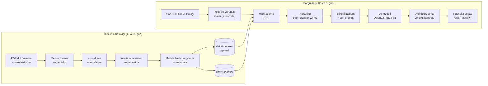

# RAG ile Kurumsal Yapay Zeka Uygulamaları Geliştirme

**Türkiye Bankalar Birliği · Online Eğitim · 14–16 Ekim 2026**
Eğitmen: **Dr. Ertürk Erdağı**

Bu repo, üç günlük eğitimin bütün uygulama materyallerini içerir: Google Colab'da çalışan üç notebook, kurgusal **Erdağı Bank** doküman seti ve sunumlar. Eğitim boyunca, banka iç dokümanları üzerinde çalışan; kaynak gösteren, yetkiye saygı duyan, ölçülebilen ve kurum içinde barındırılabilen bir RAG (Retrieval-Augmented Generation) sistemi adım adım kurulur.

> [!IMPORTANT]
> **Erdağı Bank ve bütün dokümanları kurgusaldır.** Kişiler, tutarlar, kurallar ve kimlik, hesap ve kart numaraları eğitim amacıyla üretilmiştir; gerçek bir bankayı ya da kişiyi temsil etmez. Mevzuat metinleri (6698 sayılı KVKK ve 5411 sayılı Bankacılık Kanunu) kamuya açıktır ve notebook içinde doğrudan mevzuat.gov.tr'den indirilir. Repodaki hiçbir içerik hukuki görüş değildir.

---

## İçindekiler

1. [Eğitim hakkında](#eğitim-hakkında)
2. [Hızlı başlangıç](#hızlı-başlangıç)
3. [Notebook'lar](#notebooklar)
4. [Sunumlar](#sunumlar)
5. [Kurulan sistemin mimarisi](#kurulan-sistemin-mimarisi)
6. [Günlere göre yaptığımız çalışmalar](#günlere-göre-yaptığımız-çalışmalar)
7. [Erdağı Bank doküman seti](#erdağı-bank-doküman-seti)
8. [Kullanıcılar, yetki grupları ve değerlendirme setleri](#kullanıcılar-yetki-grupları-ve-değerlendirme-setleri)
9. [Kullanılan modeller ve kütüphaneler](#kullanılan-modeller-ve-kütüphaneler)
10. [Eğitimde geçen kavramlar](#eğitimde-geçen-kavramlar)
11. [Kendi kurumunuzda uygulamak için](#kendi-kurumunuzda-uygulamak-için)
12. [Sorun giderme](#sorun-giderme)
13. [İleri okumalar](#ileri-okumalar)
14. [Repo yapısı](#repo-yapısı)

---

## Eğitim hakkında

| | |
| --- | --- |
| **Eğitim** | RAG ile Kurumsal Yapay Zeka Uygulamaları Geliştirme |
| **Düzenleyen** | Türkiye Bankalar Birliği |
| **Tarih ve biçim** | 14–16 Ekim 2026 · online · üç gün, günde üç saat |
| **Hedef kitle** | Yazılım geliştiriciler, veri bilimciler, ML mühendisleri ve teknik liderler; ağırlıklı olarak bankacılık sektörü |
| **Ön koşul** | Temel Python okuryazarlığı. Notebook'lar hazır çalışır; kod yazmak gerekmez. |
| **Ortam** | Google Colab, T4 GPU. Bütün modeller açık ağırlıklıdır ve Colab içinde çalışır; hiçbir veri dışarıdaki bir API'ye gönderilmez. |

**Eğitimin sonunda katılımcılar şunları yapabilir:**

- Bir RAG sisteminin indeksleme ve sorgu akışlarını uçtan uca açıklamak ve kurmak.
- PDF dokümanlarını temizlemek, yapısına uygun biçimde parçalamak ve metadata ile zenginleştirmek.
- Kaynak gösteren, bilmediğinde "bulamadım" diyen bir cevap üretim katmanı ve bunu sunan bir web servisi tasarlamak.
- BM25, hibrit arama, reranker, Multi-Query, HyDE ve ebeveyn parça tekniklerini doğru soruna uygulamak.
- Bir değerlendirme setiyle Hit@k, MRR, Recall@k ve sadakat metriklerini ölçmek ve sonuca göre karar vermek.
- Yetki bazlı retrieval, prompt injection savunması ve kişisel veri maskelemesi ile sistemi güvenli hale getirmek.
- Kendi kurumu için bir RAG kavram kanıtı (PoC) tasarlamak.

---

## Hızlı başlangıç

1. Aşağıdaki [notebook tablosundan](#notebooklar) ilgili günün **Colab'da aç** bağlantısına tıklayın. (Alternatif: Colab'da **Dosya › Not defteri aç › GitHub** sekmesine `erturkerdagi/tbb-rag-egitimi` yazın.)
2. Menüden **Çalışma zamanı › Çalışma zamanı türünü değiştir › T4 GPU** seçin.
3. Hücreleri yukarıdan aşağıya sırayla çalıştırın (hücrenin solundaki ▶ düğmesi ya da `Shift+Enter`). Sonraki hücreler önceki hücrelerde tanımlanan değişkenleri kullandığı için sıra atlanmamalıdır.
4. Her hücrenin önünde ne yaptığı, arkasında ise çıktısının nasıl okunacağı açıklanır.

> [!NOTE]
> **Her notebook kendi içinde bağımsızdır.** Gerekli kütüphaneleri kurar, modelleri indirir ve dokümanları bu repodan çeker. Önceki günün notebook'unu çalıştırmış olmak gerekmez.
>
> **Colab oturumları geçicidir.** Bağlantı kesildiğinde ya da oturum uzun süre boşta kaldığında sanal makine silinir; bellekteki değişkenler, indirilen dosyalar ve modeller kaybolur. Bu durumda notebook en baştan yeniden çalıştırılır.

**Tahmini süreler (T4 GPU):**

| Notebook | Hazırlık | Not |
| --- | --- | --- |
| 1. gün | Birkaç dakika | Yalnızca embedding modeli indirilir. |
| 2. gün | 10–15 dakika (Hücre 1–6) | Dil modeli yaklaşık 15 GB indirir; en uzun adım budur. |
| 3. gün | 10–15 dakika (Hücre 1–7) | 2. günle aynı üç model. Atölye (Hücre 18) her çalıştırmada 1–3 dakika sürer. |

---

## Notebook'lar

| Gün | Konu | GitHub | Colab |
| --- | --- | --- | --- |
| 1 | Temeller: token, embedding, doküman işleme, parçalama, vektör arama | [Gun1_RAG_Temeller.ipynb](https://github.com/erturkerdagi/tbb-rag-egitimi/blob/main/notebooks/Gun1_RAG_Temeller.ipynb) | [](https://colab.research.google.com/github/erturkerdagi/tbb-rag-egitimi/blob/main/notebooks/Gun1_RAG_Temeller.ipynb) |
| 2 | Cevap üretimi, RAG servisi, retrieval stratejileri, değerlendirme | [Gun2_RAG_Servis_ve_Kalite.ipynb](https://github.com/erturkerdagi/tbb-rag-egitimi/blob/main/notebooks/Gun2_RAG_Servis_ve_Kalite.ipynb) | [](https://colab.research.google.com/github/erturkerdagi/tbb-rag-egitimi/blob/main/notebooks/Gun2_RAG_Servis_ve_Kalite.ipynb) |
| 3 | Güvenlik, düzeltici RAG ve mevzuat asistanı atölyesi | [Gun3_Guvenlik_ve_Atolye.ipynb](https://github.com/erturkerdagi/tbb-rag-egitimi/blob/main/notebooks/Gun3_Guvenlik_ve_Atolye.ipynb) | [](https://colab.research.google.com/github/erturkerdagi/tbb-rag-egitimi/blob/main/notebooks/Gun3_Guvenlik_ve_Atolye.ipynb) |

<details>
<summary><b>1. gün · Gun1_RAG_Temeller · 18 hücre</b></summary>

Kurulan zincir: **PDF → temiz metin → parça + metadata → embedding vektörü → indeks → arama**

| Bölüm | Hücreler | İçerik |
| --- | --- | --- |
| 0. Ortamın hazırlanması | 1–2 | Kütüphaneler, GPU kontrolü, `BAAI/bge-m3` embedding modeli |
| 1. Token ve embedding (Canlı Demo 1.1) | 3–5 | Türkçe ve İngilizce tokenizasyon, anlam benzerliği, vektör haritası ve benzerlik matrisi |
| 2. Gerçek mevzuat PDF'i (Canlı Demo 1.2) | 6–10 | KVKK ve Bankacılık Kanunu'nun indirilmesi, metin temizliği, madde sınırları, iki parçalama yönteminin karşılaştırılması |
| 3. Erdağı Bank uygulaması (Uygulama 1) | 11–18 | Doküman ve manifest indirme, PDF önizleme, bölümlenmiş metin, metadata'lı parçalar, vektör indeksi, anlam bazlı arama, metadata filtresi, kendi sorunuzla arama |

</details>

<details>
<summary><b>2. gün · Gun2_RAG_Servis_ve_Kalite · 24 hücre</b></summary>

| Bölüm | Hücreler | İçerik |
| --- | --- | --- |
| 0. Ortamın hazırlanması | 1–6 | Kütüphaneler, kullanıcılar ve 27 soruluk değerlendirme seti, embedding modeli, `Qwen2.5-7B-Instruct` (4 bit), `bge-reranker-v2-m3`, doküman indeksi |
| 1. RAG'siz ve RAG'li cevap (Canlı Demo 2.1) | 7–9 | Bağlamsız cevap, RAG çekirdeği (`rag_cevap`), kaynaklı cevap ve atıf doğrulama |
| 2. Çalışan bir RAG servisi (Canlı Demo 2.2) | 10–12 | FastAPI ile `/health`, `/search`, `/ask`; sunucu tarafında yetki; Swagger dokümantasyon sayfası |
| 3. "Bilmiyorum" kuralı ve temperature (Uygulama 2) | 13–14 | Gevşek ve sıkı prompt; temperature'ın tutarlılığa etkisi |
| 4. Retrieval stratejileri (Canlı Demo 2.3) | 15–20 | BM25, hibrit arama (RRF), reranker, dört stratejinin karşılaştırılması, Multi-Query, HyDE, ebeveyn parça, servisin hibrit + rerank'e geçirilmesi |
| 5. Değerlendirme (Uygulama 3) | 21–24 | Hit@1, Hit@k, MRR, Recall@k; ilk sıraya gelemeyen soruların teşhisi; hakem model ile sadakat ölçümü |

</details>

<details>
<summary><b>3. gün · Gun3_Guvenlik_ve_Atolye · 19 hücre</b></summary>

| Bölüm | Hücreler | İçerik |
| --- | --- | --- |
| 0. Ortamın hazırlanması | 1–7 | Kütüphaneler, kullanıcılar, mevzuat verileri, üç model, vektör ve BM25 indeksleri, RAG çekirdeği ve arama stratejileri |
| 1. Yetki bazlı retrieval (Canlı Demo 3.1) | 8–10 | Gizli Yönetim Kurulu kararı; aynı soru, üç kullanıcı; yanlış yöntem olarak modele "söyleme" talimatı |
| 2. Dolaylı prompt injection (Canlı Demo 3.2) | 11–13 | Görünmez talimatlı tedarikçi teklifi; savunmasız sistem; ingestion taraması, kaynak güveni ve sağlam prompt ile savunma |
| 3. Kişisel veri maskeleme (Canlı Demo 3.3) | 14–15 | TCKN, IBAN, kart ve telefon tespiti (kalıp + algoritma kontrolü); maskelemenin indekslemeye eklenmesi; çıktı kontrolü |
| 4. Düzeltici RAG (Canlı Demo 3.4) | 16 | Bağlam yetersizse sorguyu yeniden yazıp tekrar arama |
| 5. Atölye: mevzuat asistanı | 17–19 | KVKK ve Bankacılık Kanunu; parçalama ve arama yapılandırmalarının 12 soruluk setle ölçülmesi; karşılaştırma tablosu; mevzuat asistanına soru |

</details>

---

## Sunumlar

Sunumlar tek dosyalık HTML sayfalarıdır; ileri ve geri düğmeleri ve klavye okları ile gezilir. **Görüntüle** bağlantısı sunumu tarayıcıda açar; **İndir** bağlantısı dosyayı indirir, indirilen dosya herhangi bir tarayıcıda çevrimdışı da açılabilir.

| Gün | Sunum | Görüntüle | İndir |
| --- | --- | --- | --- |
| 1 | LLM ve RAG temelleri, embedding, vektör veritabanı, ingestion | [Görüntüle](https://htmlpreview.github.io/?https://github.com/erturkerdagi/tbb-rag-egitimi/blob/main/presentations/RAG_Egitimi_1_Gun.html) | [RAG_Egitimi_1_Gun.html](https://github.com/erturkerdagi/tbb-rag-egitimi/raw/main/presentations/RAG_Egitimi_1_Gun.html) |
| 2 | RAG API, retrieval stratejileri, değerlendirme | [Görüntüle](https://htmlpreview.github.io/?https://github.com/erturkerdagi/tbb-rag-egitimi/blob/main/presentations/RAG_Egitimi_2_Gun.html) | [RAG_Egitimi_2_Gun.html](https://github.com/erturkerdagi/tbb-rag-egitimi/raw/main/presentations/RAG_Egitimi_2_Gun.html) |
| 3 | Güvenlik, agentic RAG, atölye | [Görüntüle](https://htmlpreview.github.io/?https://github.com/erturkerdagi/tbb-rag-egitimi/blob/main/presentations/RAG_Egitimi_3_Gun.html) | [RAG_Egitimi_3_Gun.html](https://github.com/erturkerdagi/tbb-rag-egitimi/raw/main/presentations/RAG_Egitimi_3_Gun.html) |

---

## Kurulan sistemin mimarisi

Üç günün sonunda ortaya çıkan sistem iki akıştan oluşur: dokümanları aranabilir hale getiren **indeksleme akışı** ve her soruda çalışan **sorgu akışı**.



**Temel tasarım kararları:**

- **Metadata ayrı tutulur.** Sürüm, yürürlük, gizlilik ve izinli gruplar PDF'lerin içinde değil `manifest.json` dosyasındadır; gerçek kurumlarda bu bilgiler doküman yönetim sisteminden gelir.
- **Yetki aramada uygulanır.** Kullanıcının göremeyeceği parça aday listesine hiç girmez; modele "söyleme" talimatı vermek bir güvenlik önlemi değildir.
- **Model kaynağa bağlı tutulur.** Sistem prompt'u yalnızca kaynaklara dayanmayı, cevap yoksa sabit bir "bulamadım" cümlesini, `[Kaynak N]` atıflarını ve kaynaklardaki talimatların uygulanmamasını şart koşar. Cevaptaki atıflar kodla doğrulanır.
- **Her karar ölçülür.** Arama stratejileri ve parçalama yöntemleri aynı değerlendirme setiyle karşılaştırılır.
- **Veri kurum içinde kalır.** Embedding modeli, reranker ve dil modeli açık ağırlıklıdır ve tek bir GPU'da çalışır.

---

## Günlere göre yaptığımız çalışmalar

### 1. gün · Temeller

**Konular:** Dil modellerinin çalışma mantığı ve sınırları (bilgi kesim tarihi, uydurma, kurum içi bilgiye erişememe); RAG'in "açık kitap sınavı" yaklaşımı; token ve tokenizasyon; embedding ve kosinüs benzerliği; vektör veritabanları ve yaklaşık en yakın komşu araması; doküman içe aktarma (ingestion), temizlik ve parçalama stratejileri; metadata.

**Uygulamalar:**

- **Canlı Demo 1.1:** Aynı cümlenin Türkçe ve İngilizce token sayıları karşılaştırıldı; "kart aidatı" ile "yıllık kart ücreti" gibi kelimeleri farklı, anlamı aynı ifadelerin vektör uzayında birbirine yakın durduğu gösterildi.
- **Canlı Demo 1.2:** KVKK ve Bankacılık Kanunu PDF'leri indirildi; ham metindeki gürültü (bölünmüş kelimeler, sayfa numaraları) temizlendi; madde sınırları bulundu; sabit boyutlu ve madde bazlı parçalama karşılaştırıldı.
- **Uygulama 1:** Erdağı Bank dokümanları okundu, üstbilgi, altbilgi ve filigran temizlendi, madde başlıklarına göre parçalandı, her parça metadata ile işaretlendi ve vektör indeksine kondu. Anlam bazlı arama ve yürürlük filtresinin etkisi (eski sürüm yönergenin sonuçlardan çıkması) gösterildi.

**Ana çıkarım:** RAG'in kalitesi büyük ölçüde indeksleme aşamasında belirlenir. Dokümanın kendi yapısını izleyen parçalama ve doğru metadata, sonraki bütün adımların temelidir.

### 2. gün · Servis ve kalite

**Konular:** Sorgu tasarımı; top-k seçimi; bağlam yerleştirme; sıkı prompt şablonu ve kuralların gerekçeleri; kaynak gösterme ve atıf doğrulama; izlenebilirlik; RAG servis tasarımı ve uç noktalar; BM25, hibrit arama ve Reciprocal Rank Fusion; reranker; Multi-Query, HyDE, bağlam sıkıştırma ve ebeveyn parça; değerlendirme seti; Hit@k, Recall@k, Precision@k, MRR, nDCG; LLM-as-a-judge; Ragas; teşhis matrisi ve sürekli değerlendirme.

**Uygulamalar:**

- **Canlı Demo 2.1:** Aynı soru modele önce bağlamsız, sonra RAG ile soruldu; bağlamsız modelin Erdağı Bank hakkında uydurduğu cevap ile kaynaklı ve atıfları doğrulanmış cevap karşılaştırıldı.
- **Canlı Demo 2.2:** RAG çekirdeği FastAPI ile `/health`, `/search` ve `/ask` uç noktalarına sahip bir servise dönüştürüldü; kullanıcı yetkisi sunucu tarafında belirlendi, tanımsız kullanıcıya HTTP 403 döndü.
- **Uygulama 2:** Gevşek ve sıkı prompt ile "bilmiyorum" davranışı ve temperature'ın cevap tutarlılığına etkisi ölçüldü.
- **Canlı Demo 2.3:** Semantik arama, BM25, hibrit arama ve hibrit + reranker aynı sorularda yan yana çalıştırıldı; Multi-Query, HyDE ve ebeveyn parça teknikleri denendi.
- **Uygulama 3:** Dört strateji 27 soruluk değerlendirme setinde Hit@1, Hit@3, MRR ve Recall@3 ile ölçüldü; ilk sıraya gelemeyen sorular teşhis edildi; cevapların kaynağa sadakati hakem modelle puanlandı.

**Ana çıkarım:** "Bence daha iyi oldu" yerine "şu metrik şu değerden şu değere çıktı" diyebilmek gerekir. Madde numarası gibi tam eşleşmelerde BM25, anlam sorularında semantik arama güçlüdür; hibrit arama ve reranker ikisinin iyi yanlarını birleştirir.

### 3. gün · Güvenlik ve atölye

**Konular:** RAG'e özgü tehdit haritası; yetki bazlı retrieval; doğrudan ve dolaylı prompt injection; katmanlı savunma; kişisel veri maskeleme; veri yerleşimi, KVKK ve BDDK çerçevesi; kurum içi ve bulut barındırma; referans mimari ve yayına alma kontrol listesi; agentic RAG ve ajan döngüsü; düzeltici RAG; Graph RAG; multimodal RAG; bankacılık kullanım senaryoları ve ilk projenin seçimi; PoC tasarımı.

**Uygulamalar:**

- **Canlı Demo 3.1:** "2027'de kaç şube birleştirilecek?" sorusu üç farklı yetkideki kullanıcıyla soruldu; gizli karar yalnızca üst yönetim grubundaki kullanıcının bağlamına girdi. Filtresiz ve "söyleme" talimatlı yanlış yöntemde gizli metnin modele ulaştığı gösterildi.
- **Canlı Demo 3.2:** Nova Bilişim teklifinin PDF'inde gözle görünmeyen talimat, çıkarılan metinde ortaya çıktı. Savunmasız sistem ile ingestion taraması, kaynak güveni etiketi ve sağlam sistem prompt'u olan savunmalı sistem karşılaştırıldı; iç kaynaktaki yanlış alarmın neden otomatik silinmediği gösterildi.
- **Canlı Demo 3.3:** Şikayet kaydındaki TCKN, IBAN, kart ve telefon numaraları kalıp ve doğrulama algoritmalarıyla bulunup indekslemeden önce maskelendi; yetkili kullanıcı bile numaralara ulaşamadı. İsimlerin kalıpla bulunamadığı ve NER gerektirdiği görüldü.
- **Canlı Demo 3.4:** "Eksi bakiye" gibi günlük bir ifadenin, modelin sorguyu resmi terimlerle yeniden yazmasıyla "Kredili Mevduat Hesabı" maddesine ulaştığı düzeltici RAG akışı çalıştırıldı.
- **Atölye:** KVKK ve Bankacılık Kanunu üzerinde mevzuat asistanı kuruldu; parçalama yöntemi, parça boyutu, örtüşme, arama stratejisi ve top-k kararları 12 soruluk mevzuat setiyle ölçülüp karşılaştırma tablosunda biriktirildi.

**Ana çıkarım:** Bir bankada en büyük risk yanlış cevap değil, yanlış kişiye verilen doğru cevaptır. Güvenlik modelin iyi niyetine bırakılmaz; aramada, ingestion'da ve altyapıda deterministik kurallarla sağlanır. İleri teknikler, temel iyi çalıştığı ölçülmeden eklenmez.

---

## Erdağı Bank doküman seti

Dokümanlar [`erdagi_bank/`](https://github.com/erturkerdagi/tbb-rag-egitimi/tree/main/erdagi_bank) klasöründedir. Her dokümanın metadata'sı [`manifest.json`](https://github.com/erturkerdagi/tbb-rag-egitimi/blob/main/erdagi_bank/manifest.json) dosyasında tutulur.

| Doküman | Dosya | Sürüm | Yürürlük | Durum | Gizlilik | İzinli gruplar | Kaynak |
| --- | --- | --- | --- | --- | --- | --- | --- |
| Bireysel Kredi Yönergesi | [krd-yon-v3.pdf](https://github.com/erturkerdagi/tbb-rag-egitimi/blob/main/erdagi_bank/krd-yon-v3.pdf) | 3 | 2025-07-01 | Yürürlükte | İç kullanım | tum_personel | İç |
| Bireysel Kredi Yönergesi (eski) | [krd-yon-v2.pdf](https://github.com/erturkerdagi/tbb-rag-egitimi/blob/main/erdagi_bank/krd-yon-v2.pdf) | 2 | 2023-01-01 | Yürürlükten kalktı | İç kullanım | tum_personel | İç |
| Kredi Kartı İşlemleri Prosedürü | [kart-pro.pdf](https://github.com/erturkerdagi/tbb-rag-egitimi/blob/main/erdagi_bank/kart-pro.pdf) | 5 | 2026-01-15 | Yürürlükte | İç kullanım | tum_personel | İç |
| Para Transferi Yönergesi | [eft-yon.pdf](https://github.com/erturkerdagi/tbb-rag-egitimi/blob/main/erdagi_bank/eft-yon.pdf) | 4 | 2025-11-01 | Yürürlükte | İç kullanım | tum_personel | İç |
| Mevduat ve Hesap İşlemleri Yönergesi | [mev-hes.pdf](https://github.com/erturkerdagi/tbb-rag-egitimi/blob/main/erdagi_bank/mev-hes.pdf) | 2 | 2025-03-01 | Yürürlükte | İç kullanım | tum_personel | İç |
| Ticari Kredi Teminat Yönergesi | [tic-teminat.pdf](https://github.com/erturkerdagi/tbb-rag-egitimi/blob/main/erdagi_bank/tic-teminat.pdf) | 6 | 2026-02-01 | Yürürlükte | **Gizli** | kredi_tahsis, ust_yonetim | İç |
| Bilgi Güvenliği Politikası | [bilgi-guv.pdf](https://github.com/erturkerdagi/tbb-rag-egitimi/blob/main/erdagi_bank/bilgi-guv.pdf) | 7 | 2026-04-01 | Yürürlükte | İç kullanım | tum_personel | İç |
| İnsan Kaynakları İzin Yönetmeliği | [ik-izin.pdf](https://github.com/erturkerdagi/tbb-rag-egitimi/blob/main/erdagi_bank/ik-izin.pdf) | 3 | 2025-01-01 | Yürürlükte | İç kullanım | tum_personel | İç |
| Tedarikçi Risk Değerlendirme Prosedürü | [tedarikci-pro.pdf](https://github.com/erturkerdagi/tbb-rag-egitimi/blob/main/erdagi_bank/tedarikci-pro.pdf) | 2 | 2025-09-01 | Yürürlükte | İç kullanım | tum_personel | İç |
| Yönetim Kurulu Kararı 2026/14 ³ | [yk-karar-2026-14.pdf](https://github.com/erturkerdagi/tbb-rag-egitimi/blob/main/erdagi_bank/yk-karar-2026-14.pdf) | 1 | 2026-06-20 | Yürürlükte | **Çok gizli** | ust_yonetim | İç |
| Veri Merkezi Hizmetleri Teklifi – Nova Bilişim ³ | [nova-teklif.pdf](https://github.com/erturkerdagi/tbb-rag-egitimi/blob/main/erdagi_bank/nova-teklif.pdf) | 1 | 2026-08-10 | Yürürlükte | İç kullanım | tum_personel | **Dış** |
| Müşteri Şikayet Kaydı 2026-0912 ³ | [sikayet-2026-0912.pdf](https://github.com/erturkerdagi/tbb-rag-egitimi/blob/main/erdagi_bank/sikayet-2026-0912.pdf) | 1 | 2026-09-12 | Yürürlükte | **Kişisel veri** | musteri_hizmetleri | İç |
| Metadata dosyası | [manifest.json](https://github.com/erturkerdagi/tbb-rag-egitimi/blob/main/erdagi_bank/manifest.json) | | | | | | |

³ 3. gün güvenlik senaryoları için hazırlanmıştır; manifest'te `gun3: true` ile işaretlidir ve 3. gün notebook'unda indekse sonradan eklenir.

**Dokümanların eğitimdeki rolleri:**

- **`krd-yon-v2` ve `krd-yon-v3`:** Aynı yönergenin iki sürümü farklı tutarlar içerir. Yürürlük filtresi olmadan eski sürümün cevaba karışabildiği gösterilir.
- **`tic-teminat`:** Gizli bir doküman; yetki filtresinin şube çalışanı için bu dokümanı sonuçlardan çıkardığı gösterilir.
- **`yk-karar-2026-14`:** Yalnızca üst yönetime açık, çok gizli karar (Canlı Demo 3.1).
- **`nova-teklif`:** Notlar bölümüne beyaz renkte ve çok küçük puntoyla gizlenmiş bir talimat içerir (dolaylı prompt injection, Canlı Demo 3.2).
- **`sikayet-2026-0912`:** Algoritma kontrollerinden geçecek biçimde üretilmiş **sahte** TCKN, IBAN, kart ve telefon numaraları içerir (kişisel veri maskeleme, Canlı Demo 3.3).
- **`bilgi-guv`:** Yapay zeka araçlarıyla ilgili maddesi, injection taramasında yanlış alarm örneği olarak kullanılır.
- **`tedarikci-pro`:** Yurt dışında barındırmanın yüksek risk sayıldığı prosedür; savunmalı sistemin doğru cevabı bu dokümana dayanır.
- **`mev-hes`:** Kredili Mevduat Hesabı maddesi düzeltici RAG demosunda kullanılır.

**Mevzuat metinleri** (repoda bulunmaz, notebook içinde indirilir):

| Metin | Kaynak |
| --- | --- |
| 6698 sayılı Kişisel Verilerin Korunması Kanunu | [mevzuat.gov.tr](https://www.mevzuat.gov.tr/MevzuatMetin/1.5.6698.pdf) |
| 5411 sayılı Bankacılık Kanunu | [mevzuat.gov.tr](https://www.mevzuat.gov.tr/MevzuatMetin/1.5.5411.pdf) |

---

## Kullanıcılar, yetki grupları ve değerlendirme setleri

**Kurgusal kullanıcılar** (gerçek bir sistemde bu bilgi SSO veya LDAP gibi kimlik yönetim sistemlerinden gelir):

| Kullanıcı | Yetki grupları |
| --- | --- |
| Şube çalışanı (Elif) | `tum_personel` |
| Kredi tahsis uzmanı (Murat) | `tum_personel`, `kredi_tahsis` |
| Genel müdür yardımcısı (Can) | `tum_personel`, `kredi_tahsis`, `ust_yonetim` |

Bir kullanıcı bir dokümanı, gruplarından en az biri dokümanın `allowed_groups` listesinde varsa görebilir. Şikayet kaydı yalnızca `musteri_hizmetleri` grubuna açıktır; 3. gün maskeleme demosunda bu grupla sorgulanır.

**Değerlendirme setleri:**

| Set | Notebook | Soru sayısı | İçerik |
| --- | --- | --- | --- |
| `GOLDEN_SET` | 2. gün | 27 | Erdağı Bank soruları; her birinin doğru bölümü (`doc_id::Madde X`) ve referans cevabı. 3 soru dokümanlarda cevaplanamaz; sistemin "bulamadım" demesi beklenir. Madde numaralı sorular ve eş anlamlı ifadeler bilinçli olarak karıştırılmıştır. |
| `MEVZUAT_GOLDEN` | 3. gün | 12 | KVKK ve Bankacılık Kanunu soruları; her birinin cevabının bulunduğu madde (`kvkk::Madde 11` gibi). |

---

## Kullanılan modeller ve kütüphaneler

| Bileşen | Seçim | Not |
| --- | --- | --- |
| Embedding modeli | [`BAAI/bge-m3`](https://huggingface.co/BAAI/bge-m3) | Çok dilli, Türkçe destekli; 1024 boyutlu normalize vektör; float16 |
| Dil modeli | [`Qwen/Qwen2.5-7B-Instruct`](https://huggingface.co/Qwen/Qwen2.5-7B-Instruct) | 4 bit NF4 ile yaklaşık 5,5 GB GPU belleği; seçim kutusundan `Qwen2.5-3B-Instruct` da seçilebilir |
| Reranker | [`BAAI/bge-reranker-v2-m3`](https://huggingface.co/BAAI/bge-reranker-v2-m3) | Cross-encoder; hibrit aramanın getirdiği 20 adayı yeniden sıralar |
| Anahtar kelime araması | `rank_bm25` | Türkçe için küçük harf dönüşümü ve ilk 5 harf ile basit kök alma |
| Vektör indeksi | NumPy | Eğitim ölçeğinde tam (brute-force) kosinüs araması; üretimde bir vektör veritabanı kullanılır |
| PDF işleme | `pypdf`, `pypdfium2` | Metin çıkarma ve sayfa önizleme |
| Model yükleme | `transformers`, `bitsandbytes`, `accelerate`, `sentence-transformers` | 4 bit sıkıştırma ve GPU yönetimi |
| Servis | `fastapi`, `uvicorn`, `pydantic` | `/health`, `/search`, `/ask`; otomatik Swagger dokümantasyonu |
| Ortam | Google Colab, NVIDIA T4 (16 GB) | Bütün modeller aynı GPU'da birlikte çalışır |

---

## Eğitimde geçen kavramlar

<details open>
<summary><b>Temeller</b></summary>

| Kavram | Açıklama |
| --- | --- |
| **LLM (büyük dil modeli)** | Metni token token üreten, büyük metin koleksiyonlarıyla eğitilmiş model. Eğitim verisinde olmayan kurum içi bilgiyi bilmez ve bilmediği konuda akıcı ama yanlış cevap üretebilir. |
| **RAG** | Retrieval-Augmented Generation. Soruya ilgili doküman parçalarını bulup modele bağlam olarak veren ve cevabı bu kaynaklara dayandıran mimari; "açık kitap sınavı". |
| **Token** | Modelin işlediği metin birimi; kelime, kelime parçası ya da noktalama. Türkçe metinler eklemeli yapı nedeniyle genellikle İngilizceden daha fazla token'a bölünür. |
| **Bağlam penceresi** | Modelin tek seferde okuyabildiği en fazla token sayısı. |
| **Embedding** | Bir metnin anlamını temsil eden sayı vektörü. Anlamca yakın metinlerin vektörleri birbirine yakındır. |
| **Kosinüs benzerliği** | İki vektör arasındaki açının kosinüsü; normalize vektörlerde iki vektörün nokta çarpımına eşittir. |
| **Bi-encoder** | Soru ve dokümanı ayrı ayrı vektöre çeviren model (embedding modeli). Hızlıdır; milyonlarca parçada arama yapılabilir. |
| **Vektör veritabanı** | Vektörleri saklayan ve en yakın komşu araması yapan sistem; çoğu metadata filtresi de destekler. |
| **ANN / HNSW** | Yaklaşık en yakın komşu araması ve bu iş için yaygın kullanılan graf tabanlı indeks yapısı; büyük koleksiyonlarda tam aramanın yerini alır. |
| **Ingestion (içe aktarma)** | Dokümanların okunması, temizlenmesi, parçalanması, vektöre çevrilmesi ve indekse yazılması süreci. |
| **Chunk (parça) ve parçalama** | Dokümanın aranabilir birimlere bölünmesi. Sabit boyutlu, yapıya dayalı (madde, başlık) ve anlamsal yöntemler vardır. |
| **Örtüşme (overlap)** | Ardışık parçaların paylaştığı metin; sınırdaki cümlenin kaybolmasını önler. |
| **Metadata** | Parçaya eşlik eden yapılandırılmış bilgi: sürüm, yürürlük, departman, gizlilik, izinli gruplar, kaynak. Filtreleme ve atıf için kullanılır. |
| **Başlık zinciri** | Parçanın başına eklenen "Doküman > Bölüm > Madde" bilgisi; parçanın bağlamını embedding'e taşır. |

</details>

<details>
<summary><b>Cevap üretimi ve servis</b></summary>

| Kavram | Açıklama |
| --- | --- |
| **Top-k** | Aramada getirilip modele verilen parça sayısı; kapsama ile odak arasındaki denge. |
| **Sistem prompt'u** | Modelin rolünü ve kurallarını tanımlayan talimat metni. |
| **Sıkı prompt** | Yalnızca kaynaklara dayanmayı, cevap yoksa sabit bir "bulamadım" cümlesini ve atıf yapmayı şart koşan prompt. |
| **Uydurma (hallucination)** | Modelin kaynakta olmayan bilgiyi akıcı biçimde üretmesi. |
| **Atıf doğrulama** | Cevaptaki `[Kaynak N]` numaralarının gerçekten modele verilen kaynaklara karşılık gelip gelmediğinin kodla kontrolü. |
| **Temperature** | Örnekleme rastgeleliği. 0'a yakın değerler tutarlı, yüksek değerler çeşitli cevaplar üretir; RAG'de düşük tutulur. |
| **Lost in the middle** | Modelin uzun bağlamın ortasındaki bilgiyi başı ve sonundakine göre daha az kullanma eğilimi. |
| **İzlenebilirlik** | Her isteğin soru, kullanıcı, getirilen parçalar, prompt, cevap, atıf ve sürelerle kaydedilmesi. |
| **RAG API** | RAG akışını başka uygulamaların HTTP ile çağırabildiği servis; bu eğitimde `/health`, `/search`, `/ask`. |
| **4 bit kuantizasyon (NF4)** | Model ağırlıklarının 4 bitle saklanması; bellek kullanımını büyük ölçüde azaltır, kaliteyi az etkiler. |

</details>

<details>
<summary><b>Retrieval stratejileri</b></summary>

| Kavram | Açıklama |
| --- | --- |
| **BM25** | Kelime eşleşmesine dayalı klasik sıralama fonksiyonu; madde numarası, ürün kodu ve kısaltmalarda güçlüdür. |
| **Semantik arama** | Embedding benzerliğine dayalı arama; eş anlamlı ifadelerde güçlüdür. |
| **Hibrit arama** | BM25 ve semantik aramanın sonuçlarının birleştirilmesi. |
| **RRF (Reciprocal Rank Fusion)** | Sıralı listeleri birleştirme yöntemi; her listede sırası *r* olan parça `1 / (60 + r)` puan alır. Skorların ölçeğinden bağımsızdır. |
| **Reranker / cross-encoder** | Soru ile parçayı birlikte okuyup ilgililik puanı veren model; geniş aday listesini yeniden sıralar. "Geniş getir, dar ver." |
| **Multi-Query** | Sorunun bir dil modeliyle birkaç farklı biçimde yeniden yazılması ve sonuçların birleştirilmesi. |
| **HyDE** | Hypothetical Document Embeddings. Model önce varsayımsal bir cevap yazar; arama bu cevabın vektörüyle yapılır. |
| **Bağlam sıkıştırma** | Getirilen parçalardan soruyla ilgisiz cümlelerin atılması. |
| **Ebeveyn parça (parent document)** | Küçük parçalarla isabetli arama yapıp modele parçanın ait olduğu büyük bölümü verme. |

</details>

<details>
<summary><b>Değerlendirme</b></summary>

| Kavram | Açıklama |
| --- | --- |
| **Değerlendirme seti (golden set)** | Doğru kaynağı ve referans cevabı bilinen soru seti; cevapsız sorular da içermelidir. |
| **Hit@k** | Doğru parçanın ilk k sonuç içinde olduğu soruların oranı. |
| **Recall@k / Precision@k** | Doğru parçaların ne kadarının ilk k'da bulunduğu / ilk k'nın ne kadarının doğru olduğu. |
| **MRR** | Mean Reciprocal Rank. İlk doğru sonucun sırasının tersinin ortalaması; doğru sonucun ne kadar üstte geldiğini tek sayıyla özetler. |
| **nDCG** | Dereceli ilgililiği ve sıra konumunu birlikte ölçen metrik. |
| **Sadakat (faithfulness)** | Cevaptaki iddiaların kaynaklarca desteklenme oranı. |
| **LLM-as-a-judge** | Bir dil modelinin dar ve açık bir kritere göre hakem olarak puan vermesi; uzunluk ve kendi tarzını kayırma gibi yanlılıkları vardır. |
| **Ragas** | RAG değerlendirmesi için yaygın açık kaynak kütüphane (faithfulness, answer relevancy, context precision, context recall). |
| **Teşhis matrisi** | Metrik örüntüsünden sorunun retrieval'da mı üretimde mi olduğunu çıkaran tablo. |
| **Regresyon testi** | Her değişiklikten sonra değerlendirme setinin yeniden çalıştırılması. |

</details>

<details>
<summary><b>Güvenlik</b></summary>

| Kavram | Açıklama |
| --- | --- |
| **Yetki bazlı retrieval (ACL)** | Kullanıcının yetki gruplarıyla aramanın filtrelenmesi; yetkisiz parça modele hiç ulaşmaz. |
| **Doğrudan prompt injection** | Kullanıcının sistem talimatlarını geçersiz kılmaya çalışan mesajı. |
| **Dolaylı prompt injection** | Sistemin okuduğu bir dokümana gizlenmiş talimat; RAG için en ciddi risklerden biri. |
| **Katmanlı savunma** | Ayraç ve kural, kaynak güveni, ingestion taraması, girdi/çıktı korumaları, en az yetki ve insan onayının birlikte kullanılması. |
| **Karantina** | Şüpheli dış kaynaklı içeriğin aramalardan çıkarılması; iç içerik ise insan incelemesine gider. |
| **PII / kişisel veri** | Kimliği belirli ya da belirlenebilir kişiye ait veri: TCKN, IBAN, kart numarası, telefon, isim, adres. |
| **Maskeleme** | Kişisel verinin indekslemeden önce `[TCKN]`, `[IBAN]` gibi etiketlerle değiştirilmesi. |
| **Luhn / mod 97 / TCKN algoritması** | Kart numarası, IBAN ve kimlik numarasının kontrol haneleri; kalıp eşleşmesindeki yanlış alarmı azaltır. |
| **NER** | Named Entity Recognition. İsim, kurum ve adres gibi varlıkları bulan model; kalıpla bulunamayan kişisel veriler için gerekir. |
| **Veri yerleşimi** | Verinin hangi ülkede ve hangi altyapıda işlendiği; KVKK yurt dışı aktarım ve BDDK bilgi sistemleri düzenlemeleri açısından önemlidir. |
| **Veri zehirleme** | İndekse kasten yanlış ya da yanıltıcı içerik eklenmesi. |

</details>

<details>
<summary><b>İleri mimariler</b></summary>

| Kavram | Açıklama |
| --- | --- |
| **Agentic RAG** | Aramanın ne zaman ve nasıl yapılacağına modelin karar verdiği, çok adımlı ve çok kaynaklı yaklaşım. |
| **Ajan döngüsü** | Analiz et → aracı çağır → sonucu oku → yeterli mi? → cevapla ya da tekrar dene. |
| **Araç çağırma (tool use)** | Modelin bir aracı belirli parametrelerle çağırmak için yapılandırılmış çıktı üretmesi; aracı çevredeki kod çalıştırır. |
| **MCP (Model Context Protocol)** | Modellerin araçlara ve veri kaynaklarına standart biçimde bağlanmasını sağlayan açık protokol. |
| **Düzeltici RAG (Corrective RAG)** | Modelin bulunan kaynakların yeterliliğine karar verdiği, yetersizse sorguyu yeniden yazıp tekrar aradığı sınırlı akış. |
| **Self-RAG** | Modelin ne zaman arama yapacağına ve kendi çıktısını değerlendirmeye karar verdiği yaklaşım. |
| **Graph RAG** | Varlıklar ve ilişkilerden bir graf kurup ilişki ve koleksiyon geneli sorularda kullanan yaklaşım. |
| **Multimodal RAG** | Tablo, grafik, şema ve taranmış belgelerin aranabilir hale getirilmesi. |
| **PoC** | Kavram kanıtı; üretime geçip geçmeme kararını vermek için yapılan sınırlı kapsamlı proje. |

</details>

---

## Kendi kurumunuzda uygulamak için

**Başlangıç için üç adım:**

1. **Küçük ve iyi tanımlanmış bir iç bilgi alanı seçin:** tüm personele açık, dokümanları dijital ve güncel, sahibi belli bir alan.
2. **50–100 soruluk bir değerlendirme seti hazırlayın:** gerçek kullanıcıların gerçek soruları, her birinin doğru kaynağıyla birlikte; cevapsız sorular dahil.
3. **Ölçerek ilerleyin:** her değişikliği aynı setle ölçün ve sonucu kaydedin; her seferinde tek bir ayarı değiştirin.

**İlk projeyi seçmek için beş soru:** Kaynak hazır mı? Değer ölçülebilir mi? Hata maliyeti ne? Veri ne kadar hassas? Dokümanların sahibi kim?

**PoC tasarım şablonu:**

| # | Başlık | # | Başlık |
| --- | --- | --- | --- |
| 1 | Senaryo adı ve kullanıcısı | 7 | Model ve barındırma tercihi, gerekçesi |
| 2 | Çözülen problem (tek cümle) | 8 | Yetki ve kişisel veri önlemleri |
| 3 | Kaynak dokümanlar ve sahipleri | 9 | Başarı metrikleri ve hedef değerler |
| 4 | Örnek 5 soru (biri cevapsız) | 10 | En büyük risk ve azaltma yolu |
| 5 | Parçalama ve metadata kararı | 11 | Üretime geçiş için sonraki 3 adım |
| 6 | Retrieval stratejisi | | |

**Yayına almadan önce kontrol listesi** (🔒 güvenlik maddeleri):

- [ ] Doküman kapsamı ve sahipleri belli; eski sürümler ayrışıyor
- [ ] En az 100 soruluk değerlendirme seti, cevapsız sorular dahil
- [ ] Ingestion otomatik; değişiklik, silme ve hata yönetiliyor
- [ ] Hedef metrikler tanımlı; regresyon testi her değişiklikte çalışıyor
- [ ] 🔒 Yetki filtresi aramada ve sunucuda; negatif testlerle doğrulandı
- [ ] Her istek izleniyor; log saklama KVKK ile uyumlu
- [ ] 🔒 Kişisel veri maskeleme: ingestion, sorgu ve çıktıda
- [ ] Gecikme hedefi, maliyet ve kota limitleri belli
- [ ] 🔒 Prompt injection için katmanlı savunma ve test senaryoları
- [ ] Model, embedding ve prompt sürümleri kayıtlı
- [ ] Kaynaklar gösteriliyor; kullanıcı geri bildirimi toplanıyor
- [ ] 🔒 Hukuk, uyum ve bilgi güvenliği onayı alındı

**Kod nasıl uyarlanır?** Notebook'lardaki RAG çekirdeği, arama stratejileri ve değerlendirme fonksiyonları dokümandan bağımsızdır. Kendi dokümanlarınızla çalışmak için büyük ölçüde iki adımın uyarlanması gerekir: PDF okuma ve temizlik kuralları (üstbilgi, altbilgi, filigran kalıpları) ile bölüm başlıklarını tanıyan parçalama kuralı. Metadata'yı kendi doküman yönetim sisteminizden `manifest.json` biçiminde üretmek, yetki ve yürürlük filtrelerini değiştirmeden kullanmayı sağlar.

---

## Sorun giderme

| Durum | Çözüm |
| --- | --- |
| `UYARI: GPU yok` | **Çalışma zamanı › Çalışma zamanı türünü değiştir › T4 GPU** seçin ve notebook'u baştan çalıştırın. |
| Dil modeli yüklenirken bellek hatası ya da çok uzun süre | Hücre 4'teki seçim kutusundan `Qwen/Qwen2.5-3B-Instruct` seçin. Gerekirse **Çalışma zamanı › Oturumu yeniden başlat** ile belleği temizleyin. |
| `NameError` ya da tanımsız değişken | Bir hücre atlanmış ya da oturum yenilenmiştir. Notebook'u en baştan sırayla çalıştırın. |
| mevzuat.gov.tr'den indirme başarısız | Site bazen Colab'dan gelen istekleri engeller. PDF'leri ([KVKK](https://www.mevzuat.gov.tr/MevzuatMetin/1.5.6698.pdf), [Bankacılık Kanunu](https://www.mevzuat.gov.tr/MevzuatMetin/1.5.5411.pdf)) bilgisayara indirip Colab'ın **Dosyalar** panelinden `kvkk.pdf` ve `bk.pdf` adlarıyla yükleyin, hücreyi tekrar çalıştırın. |
| GitHub'dan doküman indirilemiyor | `erdagi_bank/` klasöründeki dosyaları indirip Colab'da `erdagi_bank` adlı klasöre yükleyin; notebook klasörde bulunan dosyaları kullanır. |
| 2. gün Hücre 12'de dokümantasyon sayfası görünmüyor | Hücre çıktısındaki "yeni sekmede aç" bağlantısını kullanın. Servisin Hücre 10'da başlatılmış olması gerekir. |
| Aynı hücre farklı cevaplar veriyor | Küçük modellerin bazı davranışları (ör. gizli talimata uyma) çalıştırmadan çalıştırmaya değişebilir; bu, eğitimde vurgulanan bir noktadır. |
| Oturum bir süre sonra kapandı | Colab boşta kalan oturumları kapatır. Notebook'u baştan çalıştırın; modeller yeniden indirilir. |

---

## İleri okumalar

**RAG ve retrieval**

- Lewis ve ark. (2020). *Retrieval-Augmented Generation for Knowledge-Intensive NLP Tasks.* [arXiv:2005.11401](https://arxiv.org/abs/2005.11401)
- Reimers ve Gurevych (2019). *Sentence-BERT: Sentence Embeddings using Siamese BERT-Networks.* [arXiv:1908.10084](https://arxiv.org/abs/1908.10084)
- Chen ve ark. (2024). *BGE M3-Embedding: Multi-Lingual, Multi-Functionality, Multi-Granularity Text Embeddings.* [arXiv:2402.03216](https://arxiv.org/abs/2402.03216)
- Cormack, Clarke ve Büttcher (2009). *Reciprocal Rank Fusion outperforms Condorcet and individual Rank Learning Methods.* SIGIR. [PDF](https://plg.uwaterloo.ca/~gvcormac/cormacksigir09-rrf.pdf)
- Gao ve ark. (2022). *Precise Zero-Shot Dense Retrieval without Relevance Labels* (HyDE). [arXiv:2212.10496](https://arxiv.org/abs/2212.10496)
- Liu ve ark. (2023). *Lost in the Middle: How Language Models Use Long Contexts.* [arXiv:2307.03172](https://arxiv.org/abs/2307.03172)
- Anthropic (2024). *Introducing Contextual Retrieval.* [anthropic.com](https://www.anthropic.com/news/contextual-retrieval)
- MTEB embedding sıralaması. [Hugging Face](https://huggingface.co/spaces/mteb/leaderboard)

**Değerlendirme**

- Es ve ark. (2023). *RAGAS: Automated Evaluation of Retrieval Augmented Generation.* [arXiv:2309.15217](https://arxiv.org/abs/2309.15217) · [Dokümantasyon](https://docs.ragas.io)
- Zheng ve ark. (2023). *Judging LLM-as-a-Judge with MT-Bench and Chatbot Arena.* [arXiv:2306.05685](https://arxiv.org/abs/2306.05685)

**Güvenlik**

- OWASP. *Top 10 for Large Language Model Applications.* [owasp.org](https://owasp.org/www-project-top-10-for-large-language-model-applications/)
- Greshake ve ark. (2023). *Not what you've signed up for: Compromising Real-World LLM-Integrated Applications with Indirect Prompt Injection.* [arXiv:2302.12173](https://arxiv.org/abs/2302.12173)
- Microsoft Presidio: kişisel veri tespiti ve anonimleştirme. [Dokümantasyon](https://microsoft.github.io/presidio/)

**İleri mimariler**

- Asai ve ark. (2023). *Self-RAG: Learning to Retrieve, Generate, and Critique through Self-Reflection.* [arXiv:2310.11511](https://arxiv.org/abs/2310.11511)
- Yan ve ark. (2024). *Corrective Retrieval Augmented Generation.* [arXiv:2401.15884](https://arxiv.org/abs/2401.15884)
- Edge ve ark. (2024). *From Local to Global: A Graph RAG Approach to Query-Focused Summarization.* [arXiv:2404.16130](https://arxiv.org/abs/2404.16130)
- Faysse ve ark. (2024). *ColPali: Efficient Document Retrieval with Vision Language Models.* [arXiv:2407.01449](https://arxiv.org/abs/2407.01449)
- Model Context Protocol. [modelcontextprotocol.io](https://modelcontextprotocol.io)

**Modeller ve araçlar**

- Dettmers ve ark. (2023). *QLoRA: Efficient Finetuning of Quantized LLMs* (NF4). [arXiv:2305.14314](https://arxiv.org/abs/2305.14314)
- [Sentence Transformers](https://www.sbert.net) · [FastAPI](https://fastapi.tiangolo.com) · [Hugging Face Transformers](https://huggingface.co/docs/transformers)

**Mevzuat ve düzenleyici çerçeve**

- [6698 sayılı Kişisel Verilerin Korunması Kanunu](https://www.mevzuat.gov.tr/MevzuatMetin/1.5.6698.pdf) · [Kişisel Verileri Koruma Kurumu](https://www.kvkk.gov.tr)
- [5411 sayılı Bankacılık Kanunu](https://www.mevzuat.gov.tr/MevzuatMetin/1.5.5411.pdf) · [BDDK](https://www.bddk.org.tr)

---

## Repo yapısı

```
tbb-rag-egitimi/
├── README.md
├── notebooks/
│   ├── Gun1_RAG_Temeller.ipynb            # 1. gün · 18 hücre
│   ├── Gun2_RAG_Servis_ve_Kalite.ipynb    # 2. gün · 24 hücre
│   └── Gun3_Guvenlik_ve_Atolye.ipynb      # 3. gün · 19 hücre
├── presentations/
│   ├── RAG_Egitimi_1_Gun.html
│   ├── RAG_Egitimi_2_Gun.html
│   └── RAG_Egitimi_3_Gun.html
└── erdagi_bank/                           # kurgusal doküman seti
    ├── manifest.json                      # metadata: sürüm, yürürlük, gizlilik, izinli gruplar, kaynak
    ├── krd-yon-v3.pdf · krd-yon-v2.pdf · kart-pro.pdf · eft-yon.pdf · mev-hes.pdf
    ├── tic-teminat.pdf · bilgi-guv.pdf · ik-izin.pdf · tedarikci-pro.pdf
    └── yk-karar-2026-14.pdf · nova-teklif.pdf · sikayet-2026-0912.pdf
```

---

<sub>Hazırlayan: Dr. Ertürk Erdağı · Türkiye Bankalar Birliği için hazırlanmıştır. Erdağı Bank ve dokümanları kurgusaldır; içerik eğitim amaçlıdır ve hukuki görüş niteliği taşımaz.</sub>
